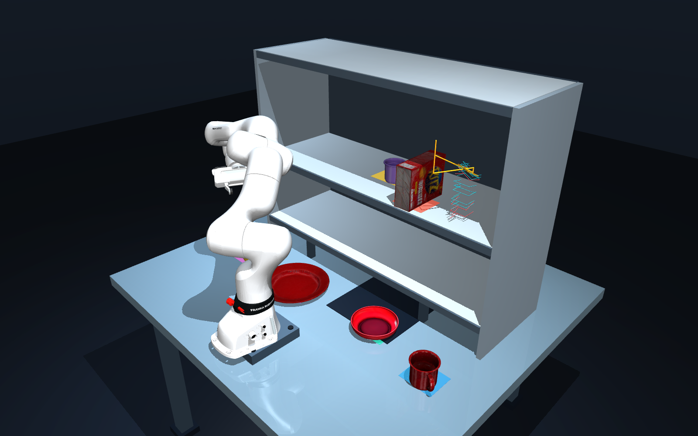

# grasp-sampler

A simple, dependency-light **parallel-jaw grasp sampler** for mesh objects.
Point it at a mesh, get back a set of grasp poses ready for IK / motion planning.

It combines three classic generators:

| Generator    | What it does |
|--------------|--------------|
| `primitives` | Top-down and side grasps on the object's bounding box |
| `obb_face`   | Grasps centered on the oriented bounding box faces |
| `antipodal`  | Dex-Net-style force-closure contacts found by ray casting |

No simulator, no robot model, no GPU. Just NumPy, trimesh, SciPy, and Open3D.

## Install

```bash
pip install -e .                 # core
pip install -e ".[viz]"          # + interactive viewer
```

Or just the dependencies: `pip install -r requirements.txt`.

## Usage

```python
from grasp_sampler import GraspSampler, stack_poses, to_world, tcp_to_ee
import numpy as np

sampler = GraspSampler()
grasps = sampler.sample("object.glb")          # list[Grasp], object-local TCP poses

# Place the object in the world and convert to Franka flange poses for IK:
object_pose = np.eye(4)                         # the object's real 4x4 world pose
tcp_world = to_world(stack_poses(grasps), object_pose)
flange_poses = tcp_to_ee(tcp_world)             # (N, 4, 4)
```

Each `Grasp` carries:

- `pose` — `(4, 4)` TCP pose in the object's local frame
- `kind` — `"top" | "side" | "obb_face" | "antipodal"`
- `width` — required finger opening (m)
- `meta` — generator-specific details

### Grasp frame convention

Grasps use the standard tool-center-point (TCP) convention:

```
+Z  approach axis   (the hand travels along +Z onto the object)
+X  closing axis    (the line between the two fingertips)
+Y  right-handed completion
```

`tcp_to_ee` converts to the Franka Panda flange frame (closing on +Y, flange
`0.105 m` behind the TCP). Pass a different `remap` / `standoff` for other grippers.

## Robot planners and simulators

Use `PlanningGrasps` for calibrated tool-link targets with aligned pregrasp,
grasp, lift, jaw widths, candidate IDs, and optional robustness scores:

```python
from grasp_sampler import PlanningGrasps
from grasp_sampler.integrations.pybullet import to_pybullet

# object_pose must describe the processed mesh frame in world coordinates.
# tcp_to_tool is the planner tool link expressed in our grasp TCP frame.
targets = PlanningGrasps.from_grasps(
    grasps, object_pose, frame_id="world", tool_link="my_tcp",
    approach_distance=0.12, lift_offset=(0, 0, 0.15),
)
position, quaternion_xyzw = to_pybullet(targets, stage="pregrasp")[0]
```

Adapters support **cuRobo** (current `GoalToolPose` and legacy 0.7 `Pose`),
**MoveIt 2**, **PyBullet / pybullet-planning**, **MuJoCo**, and **MPlib / SAPIEN**.
Planner packages are imported only when their adapters are called. See the
[planning guide](docs/planning.md) for frame/tool calibration, batch shapes,
robust-command preservation, and runnable exports/examples.

The default demo uses **MuJoCo and a Franka FR3v2** for constrained lateral and
oblique grasps inside a two-tier cabinet. The default expanded scene includes a
**Ritz box, mug, cup, plate, bowl, curved mustard bottle and blue vase**, using original
scanned textures and packaging colors. Ritz, cup and vase transfer from the
lower tier to the upper tier; the mug, plate and mustard bottle move to the table,
and the bowl uses an oblique rim grasp for a tabletop transfer. A chamfered
aluminum plate, counterbored bolt holes and recessed fasteners mount the arm.
The mug handle, cup cavity and plate rim have separate convex contact pieces.
`--suite household` retains the previous four-object scene.
`--suite classic` retains the mustard/can/foam sequence. Cyan glyphs show
candidates, coral marks rejections, and gold highlights the selection and staged
extraction path. Selection costs and rejection reasons are saved in the JSON
report; the viewer keeps the scene free of text panels and charts.



[Watch the freshly sampled MuJoCo demonstration and live grasp gallery](https://shivaram.net/grasp-sampler/).
The [robot MP4](docs/_static/videos/mujoco-live-pick-place.mp4) and
[live gallery MP4](docs/_static/videos/grasp-gallery-live.mp4) are also available directly.

For a separate **8 × 5 live gallery of all 40 object variants**, with original
source colors, slow synchronized rotation and streaming grasp candidates:

```bash
PYTHONPATH=src mjpython examples/grasp_gallery.py  # macOS; use python on Linux
```

Bright contact points and approach arrows show the candidates. Use `+` / `−`
to adjust density and `Space` to pause. See the [gallery guide](docs/visualization.md).

```bash
pip install -e ".[mujoco,fr3]"
python tools/prepare_fr3_mujoco.py          # pinned models and source materials
# macOS native viewer:
mjpython examples/pick_place_mujoco.py --gui --hold --speed 2 --fps 60
# Linux: python examples/pick_place_mujoco.py --gui --hold
# Headless physical check:
python examples/pick_place_mujoco.py --headless --report /tmp/shelf-picks.json
# Original three-object scene:
python examples/pick_place_mujoco.py --suite classic --headless
```

Viewer playback defaults to **2× speed**, with a **60 FPS refresh target**.
`--speed 1` restores real-time playback; `--fps 120` requests more frequent refresh.
These settings only affect presentation: the native 2 ms physics timestep stays
unchanged. Frame rate depends on the machine and scene.

The scene follows shelf-picking / open-cabinet retrieval setups from
MotionBenchMaker and RoboCasa; see the [paper-based scene rationale](docs/scenarios.md).
Free-space transfers use collision-checked RRT-Connect, including the held mesh;
insertion and extraction use Cartesian stages. Execution uses native actuators
and finger contact, with no object attachments or teleportation. Source material
regions preserve the FR3v2's dark accents and
markings. The separate PyBullet demo remains in `examples/pick_place_pybullet.py`.
Household asset provenance and preparation are documented in
[assets/household/README.md](assets/household/README.md).

## Robust evaluation under perceived object uncertainty

See [the uncertainty guide](docs/uncertainty.md) and run:

```bash
python examples/robust_grasp_demo.py assets/meshes/pocky_box_metric_fp.glb
```

The robot command stays fixed; only hypothetical object geometry and pose vary.
`generate_robust_grasp_set` returns grasps whose success rate over sampled
perturbations meets a threshold, validated on an independent bank:

```bash
python examples/visualize_robust_set.py assets/meshes/ycb_cracker_box_metric_fp.glb
```

The existing generators and their default behavior remain available.

## Visualize grasps

```bash
python examples/visualize.py object.glb
python examples/visualize.py object.glb --methods antipodal --max 40
```

Opens the mesh with one gripper wireframe per grasp, colored by generator
(blue = top, green = side, orange = obb, red = antipodal).

## Collision-check in PyBullet (optional)

```bash
pip install -e ".[sim]"
python examples/pybullet_demo.py assets/meshes/pocky_box_metric_fp.glb
```

Spawns the mesh and a parallel-jaw gripper proxy (no robot URDF needed) to drop
grasps whose gripper body would hit the object:

```python
from grasp_sampler.pybullet_sim import collision_filter
mask = collision_filter("object.glb", grasps, clearance=0.0)   # bool per grasp
kept = [g for g, m in zip(grasps, mask) if m]
```

## Sample meshes

`assets/meshes/` holds 31 ready-to-use objects (YCB + household items),
decimated to ~2k faces and stripped of textures (~36 KB each). Re-decimate your
own library with:

```bash
python tools/decimate_meshes.py <src_dir> assets/meshes --faces 2000
```

## Configure

Every threshold lives in `GraspConfig`:

```python
from grasp_sampler import GraspSampler, GraspConfig

cfg = GraspConfig(
    gripper_max_width=0.08,        # max finger opening (m)
    antipodal_samples=1500,        # surface points sampled
    directed=True,                 # keep only grasps from `approach_facets`
    approach_facets=((0, -1, 0),), # e.g. only approach from the front
    cone_deg=50.0,                 # half-angle of each approach cone
)
sampler = GraspSampler(cfg)
```

Set `directed=False` for a full ring of approaches around each contact pair.

## Layout

```
src/grasp_sampler/
  types.py        Grasp, ObjMesh, GraspConfig
  mesh.py         mesh loading + geometry classification
  primitives.py   bounding-box top/side grasps      (ss-pybullet, MIT)
  obb.py          oriented-bounding-box face grasps
  antipodal.py    force-closure antipodal sampler    (Dex-Net, BSD-2)
  collision.py    shared contact + gripper-body clearance checks (Open3D, trimesh fallback)
  transforms.py   object-local -> world -> flange poses
  sampler.py      GraspSampler facade
  viz.py          trimesh gripper-wireframe viewer
  uncertainty.py  pose/geometry hypothesis sampling
  robust.py       fixed-command evaluation + validity backends
  robust_set.py   robust grasp-set generation
  robust_viz.py   matplotlib uncertainty viewer
examples/
  basic.py        generate + convert to robot poses
  visualize.py    generate + view
  robust_grasp_demo.py, visualize_robust.py, visualize_robust_set.py
```

## License

MIT. Includes algorithms adapted from ss-pybullet (MIT) and Dex-Net (BSD-2);
see [LICENSE](LICENSE) for attribution.
