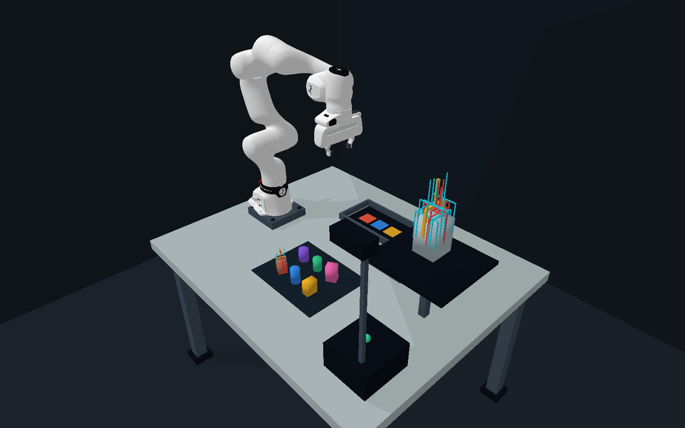

# Robot planning and simulation

`PlanningGrasps` turns nominal grasps or accepted robust commands into aligned
grasp, pregrasp and lift targets. It keeps widths, candidate IDs and validation
scores alongside the poses so filtering by IK or planning success retains their
meaning. Optional adapters cover cuRobo, MoveIt 2, PyBullet, MuJoCo, and MPlib.
Importing `grasp_sampler` does not import any of these frameworks.

## Frames and calibration

Every transform is a right-handed SE(3) matrix; positions/distances are metres.
`T_A_B` transforms B coordinates into A coordinates. The sampler's TCP has +X
closing and +Z approach. The pose requested by a planner belongs to its
configured tool link, which may differ from that TCP:

```text
T_frame_tool = T_frame_world @ T_world_mesh @ T_mesh_tcp @ T_tcp_tool
```

`tcp_to_tool` is **T_tcp_tool**, the tool link expressed in the grasp TCP.
If your calibration is T_tool_tcp, invert it first. Identity means the tool link
is the sampler TCP; naming a flange does not apply its calibration automatically.
`world_to_frame` is T_frame_world, usually the inverse of the robot base's world
pose. `frame_id` and `tool_link` label the result; there is no automatic TF lookup.

`load_mesh` normally rotates and centers input geometry. If perception gives the
pose of the original file/scene frame, call `mesh_world_pose(obj, T_world_source)`
to account for that processing. Alternatively load with `center=False` and
`upright_transform=None` to preserve the source frame.

```python
import numpy as np
from grasp_sampler import GraspSampler, PlanningGrasps, mesh_world_pose, tcp_to_ee

sampler = GraspSampler()
obj = sampler.load("object.glb")
grasps = sampler.generate(obj, seed=0)
T_world_source = np.eye(4)                  # replace with your perception pose
T_world_source[:3, 3] = [.5, 0., .2]
T_frame_world = np.eye(4)                  # replace if robot base differs from world

# Example only: existing Panda flange convention (+Y closing, 0.105 m offset).
# For other tool links use their actual calibrated T_tcp_tool.
T_tcp_tool = tcp_to_ee(np.eye(4)[None])[0]
targets = PlanningGrasps.from_grasps(
    grasps, mesh_world_pose(obj, T_world_source),
    frame_id="panda_link0", tool_link="panda_link8",
    world_to_frame=T_frame_world, tcp_to_tool=T_tcp_tool,
    approach_distance=.12, lift_offset=(0., 0., .15),
)
positions, quaternions = targets.components("pregrasp", quaternion_order="xyzw")
```

Check the configured planner link against your robot model. For example,
PyBullet's `panda_grasptarget` already includes the hand-to-fingertip offset, and
has the hand's rotation rather than the flange's rotation. Applying the flange
calibration again would displace its target.

Pregrasp moves backwards along the **original TCP's negative Z**, before tool
calibration. Lift adds `lift_offset` along **world axes**. Both preserve the
grasp orientation. These are endpoint targets; the planner/controller chooses
the motion between them.

## Preserve robustness decisions

Use the selected commands directly after robust generation:

```python
# result = generate_robust_grasp_set(...)
targets = PlanningGrasps.from_robust_result(
    result, frame_id="world", tool_link="tcp",
    approach_distance=.12, lift_offset=(0., 0., .15),
)
```

This preserves each accepted fixed world command, selected order, and
`validation_R`. Candidate IDs index `result.records`. It does not place a grasp
again using another hypothesis or a new object estimate. Scores remain
contact-model frequencies; robot reachability and path collisions are separate
checks. Pregrasp and lift motions have not been evaluated by that contact score.

After a per-candidate IK/planning query:

```python
# success_mask must have one boolean per candidate. For a CUDA tensor:
# success_mask = result.success.detach().cpu().numpy().reshape(-1)
reachable = targets.select(success_mask)
# Or reorder without losing IDs, widths, or scores:
ordered = reachable.select(list(reversed(range(len(reachable)))))
```

`widths` is the **total jaw opening**, not a joint command. For two symmetric
directly driven fingers, each joint may need `width / 2`; coupled grippers require
their own transmission mapping and limits. Open with a calibrated margin, close
after reaching the grasp, then plan lift from the actual measured state.

## cuRobo: current API and legacy 0.7

Install PyTorch/cuRobo following NVIDIA's instructions for your CUDA stack;
there is no automatic cuRobo pip extra here. The two API families are explicit
because their pose types and batch axes differ.

| API | Export | Goalset positions | Batch positions | Quaternion |
| --- | --- | --- | --- | --- |
| `current` | `curobo.types.GoalToolPose` | `(1,1,1,N,3)` | `(N,1,1,1,3)` | wxyz |
| `legacy` | `curobo.types.math.Pose` | `(1,N,3)` | `(N,3)` | wxyz |

Quaternion arrays have a final dimension of 4. Current axes are batch, horizon,
tool, goalset, components. Export covers one tool link. Multi-tool applications
must add the other configured link goals. Use the same device and dtype as the
planner:

```python
from grasp_sampler.integrations.curobo import to_curobo

# Current MotionPlanner: choose one candidate from a goalset for one start.
goal = to_curobo(targets, api="current", stage="pregrasp", device="cuda:0")
# Configure MotionPlannerCfg.create(..., max_goalset=len(targets)) before warmup.
# result = planner.plan_pose(goal, start_joint_state)

# Legacy MotionGen 0.7:
goal = to_curobo(targets, api="legacy", stage="pregrasp", device="cuda:0")
# planner.warmup(n_goalset=len(targets))
# result = planner.plan_goalset(start_joint_state, goal, plan_config)
```

`layout="goalset"` lets one start choose among N targets; its success result
describes the planning problem, **not N individual candidate outcomes**. Use
`layout="batch"` to pair N starts with N targets (current `BatchMotionPlanner`,
legacy `MotionGen.plan_batch`); repeat or provide the starting joint state with
the matching batch size and joint order. Configure maximum batch/goalset sizes
before CUDA graph warmup. `goal_arrays` exports the same arrays without importing
PyTorch/cuRobo.

`examples/plan_curobo.py` loads an exported set, checks the configured tool name,
warms up the appropriate API, and plans from the default/retract state. It does
not execute a robot. Add your application's collision scene, measured start
state, and object attachment handling when using the resulting trajectory.

Official references: [current types](https://raw.githubusercontent.com/NVlabs/curobo/main/curobo/_src/types/tool_pose.py),
[current planning](https://nvlabs.github.io/curobo/latest/getting-started/motion_planning.html),
[0.7 Pose](https://nvlabs.github.io/curobo/v0.7.6/_api/curobo.types.math.html),
[0.7 MotionGen](https://nvlabs.github.io/curobo/v0.7.6/_api/curobo.wrap.reacher.motion_gen.html).

## MoveIt 2 / ROS 2

Source your ROS workspace so `geometry_msgs` and `moveit_py` are importable.
The adapter creates `PoseStamped` messages in the supplied frame, using xyzw
quaternion fields. It does not spin a node, transform frames, or execute motion.

```python
from grasp_sampler.integrations.moveit import to_pose_stamped

messages = to_pose_stamped(targets, stage="pregrasp",
                           stamp=node.get_clock().now().to_msg())
for i, message in enumerate(messages):
    planning_component.set_start_state_to_current_state()
    planning_component.set_goal_state(pose_stamped_msg=message, pose_link=targets.tool_link)
    plan = planning_component.plan()
    if plan:
        candidate = targets.select([i])
        break
```

For a pick workflow, use that same candidate for approach, grasp and lift; after
closing, update the planning scene's attached object and allowed finger contacts.
Plan each segment from the actual or preceding planned end state. Three
independent plans from the original start do not form one executable trajectory.
See the [MoveIt Python planning tutorial](https://moveit.picknik.ai/main/doc/examples/motion_planning_python_api/motion_planning_python_api_tutorial.html).

## PyBullet / pybullet-planning

Install `pip install -e ".[sim]"`. `to_pybullet` needs only NumPy/SciPy and returns
standard `(position_xyz, quaternion_xyzw)` tuples. Supply targets in the
simulation world for the actual link being controlled:

```python
import pybullet as p
from grasp_sampler.integrations.pybullet import to_pybullet

position, quaternion = to_pybullet(targets, stage="pregrasp")[0]
joints = p.calculateInverseKinematics(robot_id, tool_link_index,
                                      position, quaternion,
                                      physicsClientId=client_id)
```

IK results follow the model's movable-DOF order, which is not necessarily its
link/joint index order. Check joint limits, FK residual, self collisions and
scene collisions before accepting a path. `pybullet-planning` accepts the same
tuple convention for its tool-pose helpers; its joint-space planners use the
corresponding IK joint solution.

The complete workstation demo uses the official **FR3v2**, a raised table and
mounting plate, a divider fixture, and a physical placement tray. It samples
antipodal grasps on six cartons/cans/a hexagonal jar, screens IK residual,
joint limits and scene collisions at five straight-approach samples, then ranks
survivors by joint travel plus a contact-centering term. These costs are planning
heuristics; they are not robustness probabilities.

The FR3v2 model's named `fr3v2_hand_tcp` frame is used directly, including its
official 0.1034 m hand offset. Its axes are calibrated to the sampler without
adding another flange standoff. Cyan candidate glyphs, coral rejections, a gold
selection, and an enlarged inspection model show the actual candidates. Phase
labels follow sampling, screening, approach, closure, lift, transfer and release.



```bash
pip install -e ".[sim,fr3]"
python tools/prepare_fr3.py
PYTHONPATH=src python examples/pick_place_pybullet.py --gui --hold --objects 6
PYTHONPATH=src python examples/pick_place_pybullet.py --headless \
    --objects 6 --report /tmp/pick-place.json --snapshot /tmp/workstation.png
```

The preparation tool downloads a pinned [official franka_description](https://github.com/frankarobotics/franka_description)
revision and converts visual COLLADA to OBJ for Bullet. Each source material
region becomes a separate visual, preserving dark joint accents and markings
instead of flattening the robot to one color. Kinematics, inertias,
joint limits and collision meshes come from the FR3v2 description. License and
provenance are retained in the ignored `assets/robots/fr3v2` cache. `--source`
accepts a local upstream checkout. The older bundled Panda remains available
with `--robot panda`; its `panda_grasptarget` frame is calibrated separately.

The simulation uses contact friction, with no fixed grasp constraints or object
teleportation. Candidate screening saves/restores the simulator to test IK poses;
execution moves the robot with motors and corrects measured placement drift.
The JSON report checks bilateral finger contact, achieved lift height, final
placement error, and records rejected candidates and selection costs.
[A recorded run](results/pybullet-pick-place.json) preserves the measured outcomes.
The overhead transfer still uses interpolated Cartesian waypoints and IK;
replace that routine with cuRobo/MoveIt for general collision-aware arm planning.

`grasp_sampler.integrations.pybullet.draw_grasps` exposes the same reusable
collision-free glyphs for other PyBullet scenes. Pass sampler-local grasps and
their object world pose, a selected index and rejected indices; remove the
returned body IDs when changing candidates. Do not pass flange poses as TCP
glyph poses.
The separate `pybullet_sim.collision_filter` still provides nominal gripper-body
screening for arbitrary meshes.

Reference: [pybullet-planning tool-pose IK](https://pybullet-planning.readthedocs.io/en/latest/reference/generated/pybullet_planning.interfaces.kinematics.compute_inverse_kinematics.html).

## MuJoCo

For the default **FR3v2 lateral tier-to-tier and tabletop demonstration**, use the existing mesh
assets and setup in {doc}`scenarios`. It includes native physics, a live grasp
selection glyphs, source material colors, and recorded physical outcomes.
Prepare it with `python tools/prepare_fr3_mujoco.py` after installing the `mujoco`
and `fr3` extras. On macOS run its viewer with `mjpython`.

`solve_site_ik(model, data, site_name, target_pose, joint_names, seed=...)` offers
non-mutating damped Jacobian IK for named hinge/slide joints. Its result preserves
joint order, limit-respecting positions, success status, position/orientation
residuals and iteration count. Targets are world transforms; it does not perform
collision checks or motion planning. The demo screens its results separately in
a scratch `MjData` and drives the native model's actuators for execution.

Install `pip install -e ".[mujoco]"` for the official `mujoco` bindings.
`to_mujoco` exports world positions and **wxyz** quaternions without importing
MuJoCo. For models that use mocap goals:

```python
from grasp_sampler.integrations.mujoco import set_mocap_target, site_world_pose, to_mujoco

positions, quaternions = to_mujoco(targets, stage="pregrasp")
set_mocap_target(model, data, "gripper_target", targets, index=0, stage="pregrasp")
actual_tcp = site_world_pose(model, data, "tcp_site")
```

`set_mocap_target` validates the named body and updates its mocap arrays, then
calls `mj_forward`. It does not modify qpos or controls. Your scene must provide
the mocap body and the weld/controller connecting it to the robot. The controlled
body/site needs the same tool calibration used to construct the targets.
For joint-driven controllers or external IK (e.g. a MuJoCo site IK controller),
use the exported matrices/arrays as Cartesian goals instead. `site_world_pose`
refreshes FK and reads a named site's current transform without overwriting it.

`examples/mujoco_targets.py /tmp/grasps.json` checks every stage with a minimal
mocap/site model, headlessly. See MuJoCo's [pose and mocap conventions](https://mujoco.readthedocs.io/en/latest/programming/simulation.html).

## MPlib / SAPIEN, and other planners

Install `pip install -e ".[mplib]"` in a compatible MPlib environment:

```python
from grasp_sampler.integrations.mplib import to_mplib

goal = to_mplib(targets, stage="pregrasp")[0]
result = planner.plan_pose(goal, current_qpos, wrt_world=True)
# Check result["status"] == "Success" before consuming its trajectory.
```

MPlib poses use wxyz quaternions. Set the planner's robot base pose consistently
and export world targets for `wrt_world=True`, or base-frame targets for
`wrt_world=False`. SAPIEN applications using MPlib can consume these same goals.
See the official [Planner](https://motion-planning-lib.readthedocs.io/latest/reference/Planner.html)
and [Pose conventions](https://motion-planning-lib.readthedocs.io/v0.2.0a1/reference/utils/pose.html).

Other Cartesian IK stacks can consume `targets.poses(stage)` or
`targets.components(stage, quaternion_order=...)`. OMPL itself plans in a
configured state space; use IK to map these targets to robot joint states before
calling its joint-space planner. This library leaves robot models, collision
worlds, joint ordering, timing, and execution under the application's control.

## Portable export

```bash
PYTHONPATH=src python examples/export_planning.py \
    assets/meshes/pocky_box_metric_fp.glb \
    --object-position .5 0 .2 --frame-id panda_link0 --tool-link panda_link8 \
    --panda-flange --output /tmp/grasps.json
```

Object position/quaternion describe the source/file frame in world coordinates.
The optional `--world-to-frame` and `--tcp-to-tool` inputs are JSON 4x4 matrices;
`--object-quaternion` uses xyzw. Without a tool calibration, the output targets
the sampler TCP. Without a frame transform, output coordinates remain world
coordinates regardless of the frame label supplied.

```python
import json
from pathlib import Path
from grasp_sampler import PlanningGrasps

Path("grasps.json").write_text(json.dumps(targets.to_dict()))
restored = PlanningGrasps.from_dict(json.loads(Path("grasps.json").read_text()))
```

The versioned schema stores frame/tool labels, metre units, candidate IDs, jaw
widths, optional validation scores, and all three 4x4 pose batches. Empty batches
round-trip. Unknown schema versions/units and malformed transforms are rejected.

## Validation scope

The tests cover nontrivial base/tool rotations and translations, source mesh
normalization, fixed robust commands, filtering/serialization, quaternion orders,
and both cuRobo batch layouts. Optional tests exercise actual PyBullet FK/IK and
MuJoCo mocap/site round trips. cuRobo constructor tests use real CPU PyTorch with
public-constructor test doubles; MoveIt and MPlib message/pose contracts use test
doubles. These checks do not substitute for CUDA planning or a configured ROS
robot integration run. The PyBullet demo's report records its physical execution.
